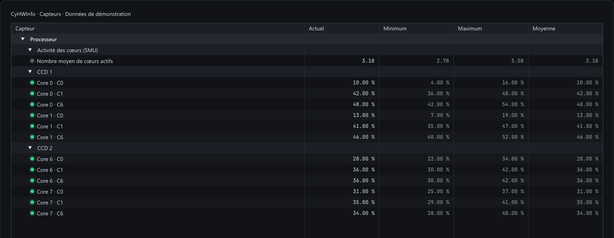

<table width="100%">
  <tr>
    <td width="300" align="left" valign="top">
      <a href="Documentation/Documentation.html#/fr/overview">Manuel hors ligne</a><br>
      <a href="https://github.com/MrMybal/CyHWInfo">Dépôt</a><br>
      <a href="README.md">English</a> · <a href="README.fr.md">Français</a>
    </td>
    <td width="400" align="center" valign="middle"></td>
    <td width="300" align="right" valign="top">
      <a href="LICENSE"><strong>MIT</strong></a><br>
      <a href="VERSION.fr.md"><strong>0.1.0</strong></a><br>
      <strong>En développement</strong>
    </td>
  </tr>
</table>

<h1 align="center">CyHWInfo</h1>

CyHWInfo est une bibliothèque C++23 modulaire pour l’inventaire matériel et la télémétrie. Lie les composants CMake dont ton application a besoin. Le tableau de bord CyUI facultatif s’intègre dans une application hôte ou s’utilise dans le moniteur Windows autonome.

> **0.1.0 · En développement.** La disponibilité des capteurs avancés dépend du matériel, du firmware, des pilotes et des droits d’accès. Consulte les [notes de version et limites de compatibilité](VERSION.fr.md).

[](Documentation/DocData/assets/sensors-fr.png)

## Ce que tu peux surveiller

- L’inventaire du processeur, du GPU, de la mémoire, du stockage, de la carte mère, de la batterie et du réseau.
- La charge et les fréquences CPU, les mesures GPU, l’activité WDDM par processus et la santé SMART NVMe/SATA sous Windows.
- Les relevés CPU et carte mère facultatifs via LibreHardwareMonitor. Les AMD Raphael pris en charge peuvent aussi exposer les températures par cœur, les limites PPT/TDC/EDC, les indicateurs PROCHOT, les timings DDR5, les débits DRAM et les résidences des états C.
- Un tableau de capteurs actualisé avec filtres, valeur actuelle, statistiques de session et source des relevés.

PawnIO est optionnel. Le moniteur Windows peut utiliser les collecteurs standard avec les capteurs avancés désactivés.

---

## Installation

La page [Releases GitHub](https://github.com/MrMybal/CyHWInfo/releases) distribue l’installateur Windows x64. L’installateur ajoute CyHWInfo au menu Démarrer et aux applications installées. Dans le moniteur, **Mises à jour** recherche la dernière version stable, vérifie le SHA‑256 de l’installateur publié par GitHub et lance l’installation à la demande. Une copie installée se ferme puis se rouvre après une mise à jour réussie. Les capteurs avancés nécessitent toujours le runtime .NET 8 et, selon les relevés, le pilote facultatif PawnIO.

Le projet est disponible sous forme de sources. Utilise Git, CMake 3.22 ou supérieur et un compilateur C++23. La compilation Windows validée utilise Visual Studio 2022 17.10 ou supérieur et un SDK Windows avec les en-têtes WDDM 2.4 et NVMe.

```powershell
git clone https://github.com/MrMybal/CyHWInfo.git
cd CyHWInfo
cmake -S . -B out/build
cmake --build out/build --config Release
cmake --install out/build --config Release --prefix out/install
```

### Lier les composants nécessaires

Configure avec `-DCYHWINFO_COMPONENTS="Gpu;GpuTelemetry"` pour l’inventaire et les mesures GPU, puis ajoute le préfixe d’installation à `CMAKE_PREFIX_PATH` dans le projet qui utilise la bibliothèque.

```cmake
find_package(CyHWInfo CONFIG REQUIRED COMPONENTS Gpu GpuTelemetry)
target_link_libraries(my_app PRIVATE CyHWInfo::Gpu CyHWInfo::GpuTelemetry)
```

### Compiler le moniteur Windows

Place une copie accessible de CyImgui_Interface à côté de CyHWInfo ou indique son emplacement dans `CYHWINFO_CYUI_SOURCE_DIR`.

```powershell
cmake -S . -B out/app -DCYHWINFO_BUILD_APP=ON
cmake --build out/app --config Release
cmake --install out/app --config Release --prefix out/install-app
& ./out/install-app/bin/CyHWInfo.exe
```

Pour inclure le collecteur avancé, ajoute `LibreHardwareMonitor` aux composants sélectionnés. Sa compilation exige un SDK compatible .NET 8 et le collecteur déployé utilise le runtime .NET 8. Installe séparément le [pilote signé PawnIO](https://pawnio.eu/) pour les relevés qui le nécessitent. Consulte le [guide de surveillance](Documentation/Documentation.html#/fr/monitoring/advanced-sensors).

### Générer une version Windows

Installe Inno Setup 6 et exécute `./scripts/package-windows.ps1` avec une copie de CyUI accessible. L’installateur est généré dans `out/windows-dist`. Le workflow **Windows release** compile et teste l’installateur. Pousse un tag `vX.Y.Z` qui correspond à la version du projet CMake pour publier une release stable sur GitHub. Pour une exécution manuelle, sélectionne le tag et active **Publish the selected version tag** pour publier après le test.

---

## Licence

CyHWInfo est sous [licence MIT](LICENSE). Les [notices de tiers](THIRD-PARTY-NOTICES.txt) et les [notices du collecteur](src/lhm_bridge/licenses/SOURCES.txt) précisent les sources et les conditions applicables.

| Bibliothèque ou source | Licence ou conditions | Utilisation |
| --- | --- | --- |
| [lfreist/hwinfo](https://github.com/lfreist/hwinfo) | MIT, avec option BSD-3-Clause pour les identifiants PCI | Inventaire et mesures |
| [gputaskman](https://github.com/shanselman/gputaskman), [CrystalDiskInfo](https://github.com/hiyohiyo/CrystalDiskInfo), [windows_exporter](https://github.com/prometheus-community/windows_exporter) | MIT | Adaptations des collecteurs WDDM et SMART |
| [LibreHardwareMonitor](https://github.com/LibreHardwareMonitor/LibreHardwareMonitor) | MPL-2.0 et [conditions des dépendances](src/lhm_bridge/licenses/SOURCES.txt) | Collecteur Windows facultatif |
| [PawnIO](https://pawnio.eu/) | Conditions distinctes du pilote et [notices des modules](src/lhm_bridge/licenses/LibreHardwareMonitor-THIRD-PARTY-NOTICES.txt) | Accès matériel facultatif |
| CyUI, [Dear ImGui](https://github.com/ocornut/imgui), [JetBrains Mono](https://github.com/JetBrains/JetBrainsMono) | MIT, MIT et OFL-1.1 | Interface facultative et moniteur Windows |
| [CyDoc](https://github.com/MrMybal/CyDoc) | MIT et notices dans l’export | Manuel hors ligne |

## Documentation

Ouvre le [manuel hors ligne](Documentation/Documentation.html#/fr/overview) depuis une copie locale du dépôt. Il couvre la [lecture des capteurs](Documentation/Documentation.html#/fr/monitoring) et l’[intégration de la bibliothèque ou du tableau de bord](Documentation/Documentation.html#/fr/integration).
