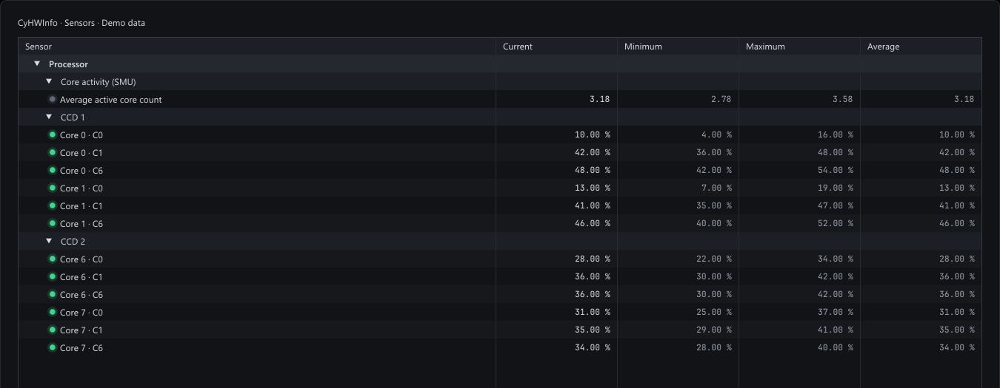

<table width="100%">
  <tr>
    <td width="300" align="left" valign="top">
      <a href="Documentation/Documentation.html#/en/overview">Offline manual</a><br>
      <a href="https://github.com/MrMybal/CyHWInfo">Repository</a><br>
      <a href="README.md">English</a> · <a href="README.fr.md">Français</a>
    </td>
    <td width="400" align="center" valign="middle"></td>
    <td width="300" align="right" valign="top">
      <a href="LICENSE"><strong>MIT</strong></a><br>
      <a href="VERSION.md"><strong>0.1.0</strong></a><br>
      <strong>In development</strong>
    </td>
  </tr>
</table>

<h1 align="center">CyHWInfo</h1>

CyHWInfo is a modular C++23 library for hardware inventory and telemetry. Link the CMake components your application needs. The optional CyUI dashboard can be embedded in a host application or run as the standalone Windows monitor.

> **0.1.0 · In development.** Advanced sensor coverage depends on the hardware, firmware, drivers and access rights. See the [version notes and compatibility limits](VERSION.md).

[](Documentation/DocData/assets/sensors-en.png)

## What you can monitor

- CPU, GPU, memory, storage, motherboard, battery and network inventory.
- CPU load and clocks, GPU telemetry and per-process WDDM usage, and NVMe/SATA SMART on Windows.
- Optional CPU and motherboard readings through LibreHardwareMonitor. Supported AMD Raphael systems can also expose CPU core temperatures, PPT/TDC/EDC, PROCHOT, DDR5 timings, DRAM bandwidth and C-state residency.
- A live sensor table with filtering, current readings, session statistics and source information.

PawnIO is optional. The Windows monitor can use the standard collectors with advanced sensors disabled.

---

## Installation

The [GitHub releases](https://github.com/MrMybal/CyHWInfo/releases) page is the distribution point for the Windows x64 setup. The installer adds CyHWInfo to the Start menu and to Installed apps. In the monitor, **Updates** checks the latest stable release, verifies the installer SHA‑256 against GitHub and starts the installation on request. An installed copy closes and reopens after a successful upgrade. The advanced collector needs the .NET 8 Runtime, and some readings also require the optional PawnIO driver.

The project is available as source. Use Git, CMake 3.22 or later and a C++23 compiler. The validated Windows build uses Visual Studio 2022 17.10 or later and a Windows SDK with WDDM 2.4 and NVMe headers.

```powershell
git clone https://github.com/MrMybal/CyHWInfo.git
cd CyHWInfo
cmake -S . -B out/build
cmake --build out/build --config Release
cmake --install out/build --config Release --prefix out/install
```

### Link only the components you need

Configure with `-DCYHWINFO_COMPONENTS="Gpu;GpuTelemetry"` for GPU inventory and telemetry, then add the installation prefix to the consumer's `CMAKE_PREFIX_PATH`.

```cmake
find_package(CyHWInfo CONFIG REQUIRED COMPONENTS Gpu GpuTelemetry)
target_link_libraries(my_app PRIVATE CyHWInfo::Gpu CyHWInfo::GpuTelemetry)
```

### Build the Windows monitor

Place an accessible CyImgui_Interface checkout beside CyHWInfo or set `CYHWINFO_CYUI_SOURCE_DIR` to its location.

```powershell
cmake -S . -B out/app -DCYHWINFO_BUILD_APP=ON
cmake --build out/app --config Release
cmake --install out/app --config Release --prefix out/install-app
& ./out/install-app/bin/CyHWInfo.exe
```

To include the advanced collector, add `LibreHardwareMonitor` to your selected components. It needs a .NET SDK that can build .NET 8 and uses the .NET 8 Runtime when deployed. Install the [signed PawnIO driver](https://pawnio.eu/) separately for readings that require it. See the [monitoring guide](Documentation/Documentation.html#/en/monitoring/advanced-sensors).

### Package a Windows release

Install Inno Setup 6 and run `./scripts/package-windows.ps1` with a CyUI checkout available. The installer is written to `out/windows-dist`. The **Windows release** workflow builds and tests the installer. Push a `vX.Y.Z` tag matching the CMake project version to publish a stable GitHub release. For a manual run, select the tag and enable **Publish the selected version tag** to publish after the test.

---

## License

CyHWInfo is licensed under the [MIT License](LICENSE). The [third-party notices](THIRD-PARTY-NOTICES.txt) and [collector notices](src/lhm_bridge/licenses/SOURCES.txt) document the corresponding sources and terms.

| Library or source | License or terms | Use |
| --- | --- | --- |
| [lfreist/hwinfo](https://github.com/lfreist/hwinfo) | MIT with BSD-3-Clause option for PCI ID data | Inventory and telemetry |
| [gputaskman](https://github.com/shanselman/gputaskman), [CrystalDiskInfo](https://github.com/hiyohiyo/CrystalDiskInfo), [windows_exporter](https://github.com/prometheus-community/windows_exporter) | MIT | WDDM and SMART collector adaptations |
| [LibreHardwareMonitor](https://github.com/LibreHardwareMonitor/LibreHardwareMonitor) | MPL-2.0 and [dependency terms](src/lhm_bridge/licenses/SOURCES.txt) | Optional Windows collector |
| [PawnIO](https://pawnio.eu/) | Separate driver terms and [module notices](src/lhm_bridge/licenses/LibreHardwareMonitor-THIRD-PARTY-NOTICES.txt) | Optional hardware access |
| CyUI, [Dear ImGui](https://github.com/ocornut/imgui), [JetBrains Mono](https://github.com/JetBrains/JetBrainsMono) | MIT, MIT and OFL-1.1 | Optional UI and Windows monitor |
| [CyDoc](https://github.com/MrMybal/CyDoc) | MIT and notices in the export | Offline manual |

## Documentation

Open the [offline manual](Documentation/Documentation.html#/en/overview) from a local checkout. It covers [reading sensors](Documentation/Documentation.html#/en/monitoring) and [integrating the library or dashboard](Documentation/Documentation.html#/en/integration).
